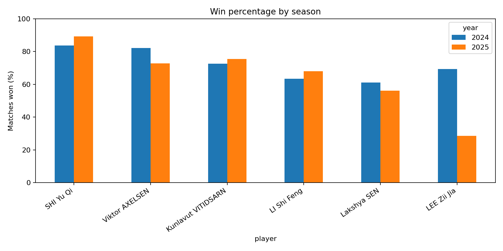
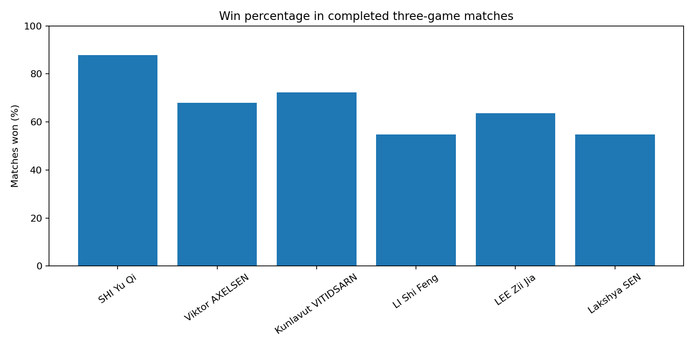

# Badminton Performance: A Statistical Study of Elite Men's Singles (2024–2025)

**Research area:** Statistics / Applied Mathematics  
**Methods:** Python, pandas, descriptive statistics, Wilson intervals, matplotlib  
**Status:** Analysis executed on the public match dataset; results are included below and in the linked tables and report at the repository root.

## Research question
How do six selected elite men's singles players differ in their observed match win percentages, year-to-year variation, first-game conversion, and three-game match results?

This is a descriptive observational case study, **not** a player ranking, a causal experiment, or a predictive model.

## Dataset and study design
Source: [SahilMotyar/bwf-match-data](https://github.com/SahilMotyar/bwf-match-data), a third-party compilation of public badminton match results (not an official research publication).

- All men's singles main-draw records dated **2024-01-01 through 2025-12-31** involving at least one of the six players
- Six selected players: SHI Yu Qi, Viktor AXELSEN, Kunlavut VITIDSARN, LI Shi Feng, Lakshya SEN, LEE Zii Jia
- **454 distinct match records**; these become **488 player-match observations** because a match between two selected players contributes one observation to each player's individual record
- **475 player-match observations** have validated complete scorelines and enter game-level calculations
- Qualifying rounds are excluded; quarterfinals are included. Match results with incomplete scores can contribute to overall win percentages, but not to game-specific analyses.

## Results

### Overall match records

| Player | Wins | Matches | Win % |
|---|---:|---:|---:|
| SHI Yu Qi | 82 | 95 | 86.3% |
| Viktor AXELSEN | 48 | 61 | 78.7% |
| Kunlavut VITIDSARN | 80 | 108 | 74.1% |
| LI Shi Feng | 60 | 91 | 65.9% |
| LEE Zii Jia | 36 | 56 | 64.3% |
| Lakshya SEN | 45 | 77 | 58.4% |

SHI Yu Qi had the highest **observed** match win percentage in this selected sample, but this is not an opponent-adjusted measure of player strength.


### Comparing 2024 and 2025

LEE Zii Jia had the largest observed change, from **69.4% (34/49)** in 2024 to **28.6% (2/7)** in 2025, a difference of **−40.8 percentage points**. The seven-match 2025 sample is too small to support a confident claim that underlying ability declined. This is a useful example of why denominators matter.



### First-game conversion

Of **315 selected-player observations** where the player won the first game of a *validated completed match*, **282** were match wins: **89.5%**. This is a descriptive conditional proportion, not evidence that the first-game win independently causes a match win.


### Three-game matches

Among **178 selected-player observations** in validated completed three-game matches, **120** ended in wins (**67.4%**). These are selected-player observations, not 178 distinct matches, and are not a test of “clutch ability.”



## How the analysis works
1. Read the source match file and filter to the study period, discipline, and main draw.
2. Remove exact duplicate records and restrict to matches involving the selected players.
3. Validate completed game scores before game-level analyses.
4. Convert match-level records into player-level observations.
5. Count wins and matches, calculate descriptive percentages and Wilson intervals, and generate figures and result tables.
6. Explain sample size and design limitations before drawing conclusions.

## Reproduce the analysis

Install Python 3 and Jupyter, then from the project directory run:

```bash
pip install -r requirements.txt
jupyter notebook
```

Open `Badminton_Statistical_Analysis.ipynb` and use **Run All Cells**. The notebook looks for `data/ms.csv` first and otherwise attempts to download it from the linked source. When run locally, four charts are saved to `figures/`, summary CSV tables and `FINAL_REPORT.md` to `results/`, and derived player-level observations to `data/`. For ease of browsing, the published repository stores copies of the charts, tables, and report at the repository root.

**For this repository:** the raw third-party `ms.csv` is not redistributed; the user must obtain it from the source if offline. The saved notebook and published outputs were generated from the source CSV and checked for basic internal consistency.

## Limitations
- These are nonrandomly selected players, not all men's singles competitors.
- Match counts and opponent strength differ; win percentages are not opponent-adjusted.
- Year-to-year comparisons may be unstable with small samples, especially the seven matches for LEE Zii Jia in 2025.
- Game-level analysis omits records lacking complete, consistent scores.
- Some matches between chosen players appear twice in the player-view table, once from each player's perspective. Counts of observations must not be mislabeled as distinct matches.
- Repeated matches, nonrandom samples and uneven opponent strength limit the interpretation of the descriptive 95% Wilson intervals.
- These statistics do not establish cause-and-effect or predict future performance.

## Files
- `Badminton_Statistical_Analysis.ipynb` — full analysis, code explanations, and executed outputs
- `overall_win_percentages.png`, `year_comparison.png`, `first_game_conversion.png`, `three_game_performance.png` — four plots
- `overall_summary.csv`, `annual_summary.csv`, `first_game_conversion.csv`, `three_game_summary.csv` — computed tables
- `FINAL_REPORT.md` — findings, limitations and conclusion
- `requirements.txt` — dependencies

## Source credit
Sahil Motyar, [bwf-match-data](https://github.com/SahilMotyar/bwf-match-data). The analysis is independent of BWF and the dataset maintainer.
