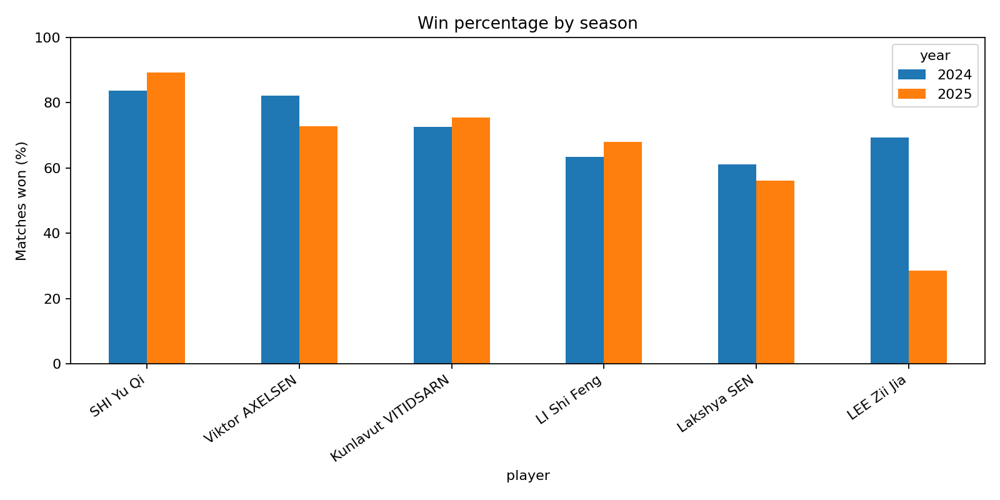
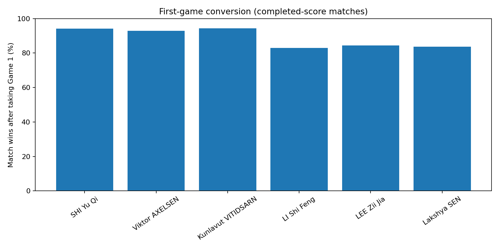

# Badminton Player Performance Analysis (2024–2025)

**Focus:** Statistics and Applied Mathematics  
**Tools:** Python, pandas, matplotlib  
**Data:** Public men's singles badminton match records

## About the project

I follow professional badminton and wanted to look at match results from a statistical point of view. Instead of only comparing tournament titles or world rankings, this project looks at match win rates and a few situations within matches.

I used publicly available results from 2024 and 2025 to compare six men's singles players: SHI Yu Qi, Viktor AXELSEN, Kunlavut VITIDSARN, LI Shi Feng, Lakshya SEN, and LEE Zii Jia.

The goal is to make clear comparisons using basic statistics, not to decide who is the best player.

## Questions

- How do the six players' overall win rates compare?
- What changed between 2024 and 2025?
- How often did players win the match after winning the first game?
- How did they perform in matches that went to a third game?

## Data and method

The records come from [Sahil Motyar's badminton match dataset](https://github.com/SahilMotyar/bwf-match-data), a third-party collection of public tournament results. It is not an official BWF research dataset.

I looked at men's singles main-draw matches from **2024–2025** involving at least one of these six players. The analysis includes **454 separate matches**. For individual player statistics, the program creates a record for each selected player in a match. That gives **488 player-match records**, because matches between two selected players count once for each player.

For the first-game and third-game questions, I used only records with complete, consistent scores: **475 player-match records**. Matches with incomplete scores still count toward overall results when the winner is known.

The Python notebook filters the data, checks for duplicates and incomplete scores, calculates percentages, and makes the charts shown below. The percentage of matches won is calculated as **wins ÷ matches × 100**.

## Results

### 1. Overall win rate

| Player | Wins | Matches | Win rate |
|---|---:|---:|---:|
| SHI Yu Qi | 82 | 95 | 86.3% |
| Viktor AXELSEN | 48 | 61 | 78.7% |
| Kunlavut VITIDSARN | 80 | 108 | 74.1% |
| LI Shi Feng | 60 | 91 | 65.9% |
| LEE Zii Jia | 36 | 56 | 64.3% |
| Lakshya SEN | 45 | 77 | 58.4% |

SHI Yu Qi had the highest win rate in this dataset, winning **82 of 95 matches (86.3%)**. This is a comparison of recorded results, though, not a complete measure of who is stronger. The players did not all face the same opponents.


### 2. Changes between 2024 and 2025

SHI Yu Qi's win rate went from **83.7% in 2024** to **89.1% in 2025**. LEE Zii Jia had the biggest drop in the selected data, from **69.4% (34/49)** to **28.6% (2/7)**.

The second number needs context: LEE Zii Jia had only **seven** eligible matches in 2025. With such a small sample, a few match results can make the percentage change a lot. I would not use this result alone to say his playing ability declined by the same amount.



### 3. Winning the first game

For the selected player records with complete scores, winning the first game was followed by a match win **282 out of 315 times (89.5%)**.

That is a strong connection in these results, but it is not surprising: a player must win two games to win the match. This number describes what happened in the sample; it does not show that winning Game 1 independently *caused* the final win.


### 4. Three-game matches

Among the selected player records in completed three-game matches, **120 out of 178 (67.4%)** ended in wins. This number is based on player records, not 178 different matches, since some matches involve two players in the study.

The chart compares their results in longer matches. It does not, by itself, tell us who handles pressure best.



## What I learned

The main lesson for me is that percentages need context. A win rate can look impressive or disappointing, but the number of matches and the level of competition matter. Comparing just the percentages can miss an important part of the story.

This project also gave me a practical way to use Python for organizing sports data, checking records, and turning calculations into charts.

## Limits of the analysis

- Only six players and two years are included.
- Players had different numbers of matches and faced different opponents.
- The source is a third-party dataset, so missing or incorrect records are possible.
- Some matches were left out of game-by-game analysis because the scores were incomplete.
- The results show patterns in recorded matches, not cause and effect or predictions of future matches.

## Files and how to run

- [`Badminton_Statistical_Analysis.ipynb`](Badminton_Statistical_Analysis.ipynb) — Python code, calculations, and charts
- [`FINAL_REPORT.md`](FINAL_REPORT.md) — a short discussion of the findings
- `overall_summary.csv`, `annual_summary.csv`, `first_game_conversion.csv`, `three_game_summary.csv` — summary tables
- Four `.png` files — charts displayed above
- `requirements.txt` — Python packages used

To run the notebook locally, install Python and Jupyter, then use:

```bash
pip install -r requirements.txt
jupyter notebook
```

Open `Badminton_Statistical_Analysis.ipynb` and select **Run All Cells**. It reads `data/ms.csv` when available, or tries to download the source data. The notebook saves its generated outputs under `figures/` and `results/`; copies of the final charts and tables are also provided at the top level of this repository.

**Data credit:** [Sahil Motyar — bwf-match-data](https://github.com/SahilMotyar/bwf-match-data). The project is not affiliated with BWF or the dataset maintainer.
